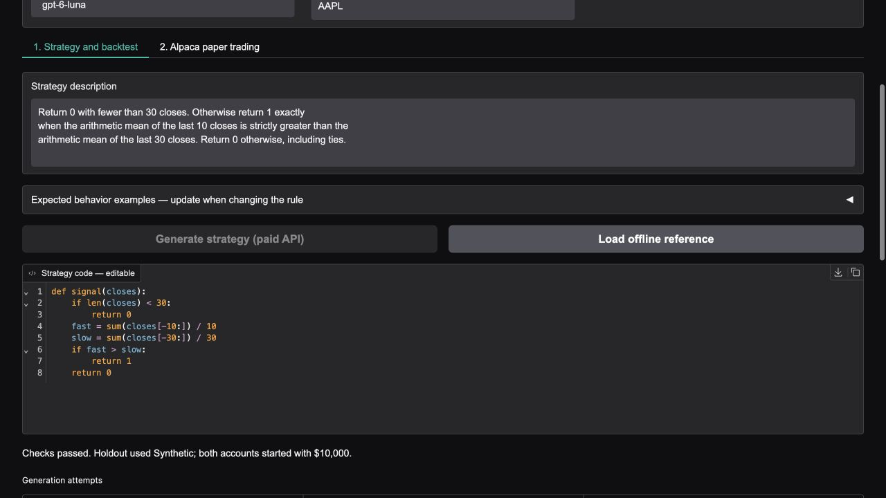
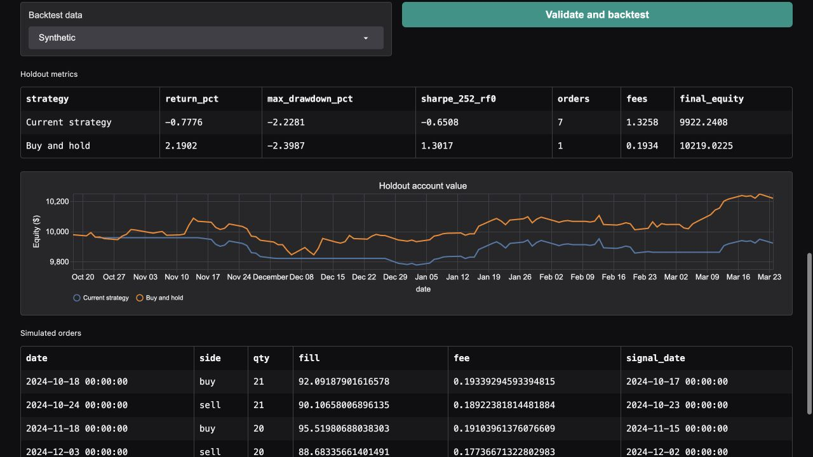
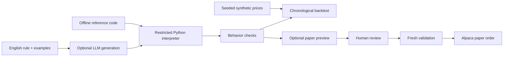
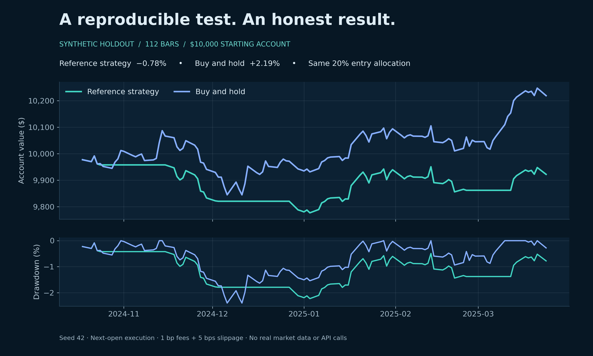

<p align="center">
  
</p>

# Strategy Code Lab

**Plain English → constrained Python → behavioral checks → backtest → optional Alpaca paper order.**

[](https://github.com/SeeBurtOh/strategy-code-lab/actions/workflows/checks.yml)


I built this project to answer a practical AI engineering question: **how do I turn a model's code into something I can inspect, test, and use through a clearly defined API?**

The application generates a small strategy function, checks its behavior, and evaluates it with a chronological backtest. An optional adapter connects that function to Alpaca's paper-trading environment. Python handles the validation, simulation, and broker integration; the LLM only writes the strategy.

**Try it without an account.** The default app uses a hand-written reference strategy and seeded synthetic prices. It does not load `.env`, call an LLM, or connect to Alpaca. Once dependencies are installed, the demo runs locally without internet access. The concept artwork above is AI-generated; the screenshots and results below come from the actual application.

[Quick start](#quick-start) · [Screenshots](#screenshots) · [Architecture](#architecture) · [Use your own API keys](#use-your-own-api-keys) · [Validation](#validation)

## Quick start

Use **Python 3.12**. Clone the repository and create a virtual environment:

```bash
git clone https://github.com/SeeBurtOh/strategy-code-lab.git
cd strategy-code-lab
python3.12 -m venv .venv
source .venv/bin/activate
pip install -r requirements.txt
python app.py
```

On Windows, create the environment with `py -3.12 -m venv .venv` and activate it with `.venv\Scripts\Activate.ps1` in PowerShell. Run the remaining commands as shown above.

Open **http://127.0.0.1:7860**. If that port is busy, use `python app.py --port 7866`.

1. Click **Validate and backtest** to run the included moving-average strategy.
2. Inspect the holdout metrics, equity chart, and simulated order ledger.
3. Change the strategy code and run it again. For example, replace its final `return 0` with `return 1` to see the behavior checks reject it.
4. Click **Load offline reference** to restore the original code and examples.

The demo does **not** generate new code offline. New LLM generations require your own API key and connected mode. Changing only the English description does not change the loaded Python function.

## Screenshots

### Inspect the strategy



### Check the result



These screenshots use synthetic data and contain no account information or credentials.

## What I built

| Component | Responsibility |
| --- | --- |
| **Generation loop** | Ask a model for `signal(closes)`, validate the response, and allow up to two total attempts with feedback. Record latency, token usage, and validation outcome. |
| **Restricted interpreter** | Parse Python's AST and interpret an allowlisted subset. No `exec`, `eval`, imports, arbitrary attributes, or loops in generated code. |
| **Behavior checks** | Test warmup, ties, trends, and reversals. Compare the reference rule against independently calculated randomized examples. |
| **Backtest engine** | Calculate each signal from available historical closes and fill at the following open. Track cash, whole shares, fees, slippage, drawdown, and orders. |
| **Paper broker adapter** | Preview first, require review, revalidate before submission, and reconcile ambiguous responses using deterministic order IDs. |
| **Gradio + notebook** | Share one engine across an interactive interface and a step-by-step experiment notebook. |
| **Offline boundary** | Disable provider callbacks on the server by default, even if a browser request is modified. |

## Architecture



The model implements one narrow contract:

```python
def signal(closes):
    if len(closes) < 30:
        return 0
    fast = sum(closes[-10:]) / 10
    slow = sum(closes[-30:]) / 30
    if fast > slow:
        return 1
    return 0
```

`1` means the desired state is a long position; `0` means cash. It does not mean “buy another share every day.” The host application translates a change in the desired state into an order and handles position sizing separately. The generated function never receives API keys or broker clients.

The interpreter deliberately supports a small language. It is an educational execution boundary, not a general-purpose sandbox for arbitrary Python or a hardened public hosting service.

## A reproducible result



| Synthetic holdout | Reference strategy | Buy and hold |
| --- | ---: | ---: |
| Account return | −0.78% | +2.19% |
| Final account value | $9,922.24 | $10,219.02 |
| Simulated orders | 7 | 1 |

Both accounts start at $10,000 with a 20% entry allocation, 1 basis point of fees, and 5 basis points of slippage. The fixture contains 320 synthetic bars with seed 42; the last 35% is the holdout. Positions still open at the end are marked to the final close, rather than forcibly liquidated.

**Correct code does not establish a profitable strategy.** This example passes the behavior checks and still loses money on the synthetic holdout. The result tests the software; it says nothing about expected market returns. Repeatedly adjusting a rule after inspecting this holdout would also stop it being an independent evaluation.

The raw result is in [`assets/demo-results.json`](assets/demo-results.json). To regenerate the chart and result after installing the development dependencies:

```bash
python scripts/export_demo.py
```

## Use your own API keys

Sharing the repository does not share my accounts. Every person running connected mode supplies their own credentials, pays for their own model requests, and uses their own Alpaca paper account.

1. Copy `.env.example` to `.env` in this repository.
2. Set `OPENAI_API_KEY` if you want model generation.
3. Set `ALPACA_PAPER_API_KEY` and `ALPACA_PAPER_SECRET_KEY` if you want Alpaca data or paper trading. Use keys from your **paper** environment.
4. Start the app with:

```bash
python app.py --connected
```

Only enable the services you need. OpenAI generation does not require Alpaca keys, and the authored reference can connect to Alpaca without an OpenAI key. The model dropdown defaults to `gpt-6-luna` and accepts a custom model ID; access depends on your API account.

For a paper trade, enable **Alpaca paper-account access**, then open the second tab:

1. **Check paper connection** to read the account and market clock.
2. **Preview paper order** to inspect the current proposed action.
3. If the preview is BUY or SELL, review the details and select **I reviewed this paper order**.
4. **Submit reviewed paper order**, then **Refresh order status**. Accepted is not the same as filled.

A HOLD response is expected when the regular session is closed, an order already exists, or the position already matches the signal. Paper execution uses current quotes and limit orders; it will not exactly match the historical next-open simulator. Entry orders are limited by the selected budget (up to $1,000 of paper money), 10% of account equity, and available cash. Exits close the existing eligible whole-share position, so the entry budget is not an exit cap. Use a dedicated paper account for this project.

The launcher binds to `127.0.0.1` with public Gradio sharing disabled. Do not expose a connected instance publicly with your keys: other visitors could use the server's credentials. This repository is intended for local use, not an authenticated multi-user deployment.

## Explore the notebook

```bash
pip install -r requirements-dev.txt
python -m jupyterlab
```

Open [`alpaca_strategy_codegen.ipynb`](alpaca_strategy_codegen.ipynb). It walks through the contract, generation and repair, independent checks, backtest accounting, cost sensitivity, model comparisons, and optional paper execution. All API, submission, export, and UI-launch switches are off in the committed notebook.

To use a local `.env` in the notebook, explicitly set `LOAD_LOCAL_CREDENTIALS = True`, then enable only the experiment you intend to run. Never save keys in a cell. Clear outputs before committing a notebook that has accessed an account.

## Validation

```bash
pip install -r requirements-dev.txt
python -m unittest discover -s tests -v
python scripts/check_notebook.py
python scripts/check_secrets.py
```

The 50 tests cover interpreter rejection cases, randomized behavior, accounting and timing, provider repair, paper-order guards, stale previews, ambiguous submission responses, UI state, and the offline boundary. Broker and model calls in the test suite are mocked. The notebook check blocks provider clients and executes the default path in a fresh kernel. GitHub Actions runs these checks without API secrets.

Before the portfolio release, I also verified a fresh dependency installation and exercised the offline interface in a browser. Earlier connected development verified Alpaca paper authentication and historical data retrieval; **an actual paper-order fill remains untested**.

## Credentials and publishing

- `.env.example` contains empty placeholders. `.env`, local exports, private key files, and notebook checkpoints are ignored.
- The public notebook has no saved execution outputs. Screenshots show only the offline demo.
- `scripts/check_secrets.py` checks publishable files and Git history for common credential patterns. It can also compare against actual values in a private dotenv file using `--compare-env /path/to/private/.env`; it never prints those values.
- The portfolio starts with fresh Git history rather than copying the course repository's history. Before publication, its files and history were compared against my local credential values.

The focused scanner is a release check, not a guarantee that every possible secret format can be detected. Keep account data and credentials out of committed files, even when a filename is ignored: Git ignores do not remove files already tracked.

## Project map

```text
app.py                          Local launcher; offline by default
gradio_app.py                   Interface and server-side connection gates
strategy_lab.py                 Restricted interpreter, generation, backtest
paper_broker.py                 Alpaca paper-account adapter
alpaca_strategy_codegen.ipynb    Guided engineering walkthrough
tests/                          Offline unit and integration checks
scripts/                        Notebook, release, and chart utilities
assets/                         Concept artwork, real screenshots, demo results
.github/workflows/checks.yml     Credential-free CI
```

## What I would build next

I would add a second strategy with its own independent oracle, repeat model trials to measure consistency, and record a reviewed paper-order lifecycle during market hours. A public hosted version would need a separate design for authentication, per-user credentials, resource limits, and isolation.

## Background and attribution

I started this project during Week 4 of [Ed Donner's LLM Engineering course](https://github.com/ed-donner/llm_engineering), using his idea of generating trading code against a simulated equities API. This standalone portfolio extends my [course contribution](https://github.com/ed-donner/llm_engineering/pull/4112) with an offline launcher, tests, documentation, and visuals.

Built by **Christopher Burt ([SeeBurtOh](https://github.com/SeeBurtOh))**. Educational software for simulation; no live-money trading endpoint is implemented.

The hero is custom conceptual artwork generated with the built-in image-generation tool; its [prompt and asset notes](assets/README.md) are included. The backtest figure is plotted from the included engine, and the screenshots are captures of the running offline app.

[MIT license](LICENSE).
